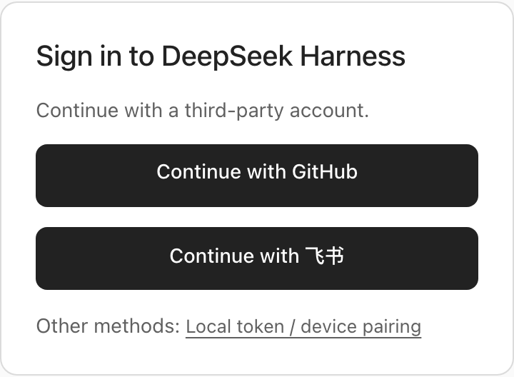
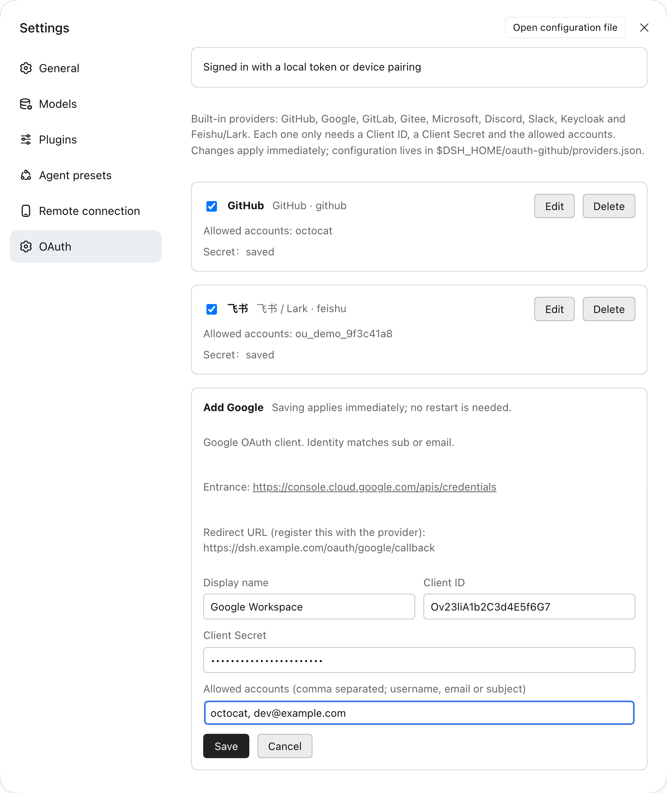
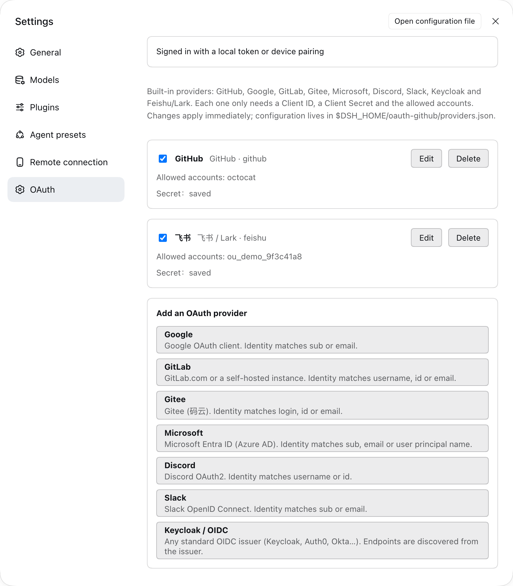
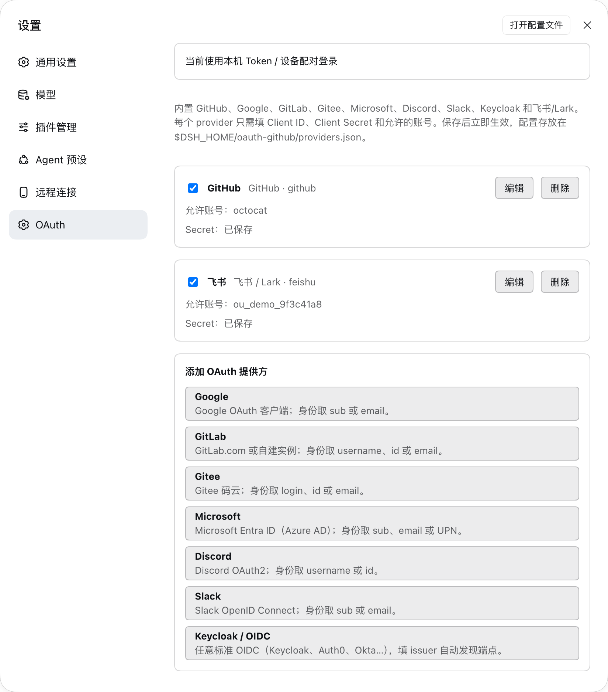

# dsh-oauth

**Sign in to DeepSeek Harness with the accounts you already have.**

[](https://www.npmjs.com/package/@dshj/dsh-oauth)
[](https://github.com/DSHJJJ/dsh-oauth/actions/workflows/ci.yml)
[](LICENSE)



OAuth / OIDC sign-in for [DeepSeek Harness](https://github.com/deepseek-ai/deepseek-harness) Web, built as a DSH bundle.
Nine providers are built in — **GitHub, Google, GitLab, Gitee, Microsoft Entra, Discord, Slack, Keycloak/any OIDC issuer and Feishu/Lark** — and
you configure them from **Settings → OAuth**: pick a provider, paste its client ID and secret, list who is allowed.
The next request uses it. No restart, no environment variables, no YAML.

## Why this exists

DSH 0.2.3 opens authentication to plugins: anything that can verify a credential can register with
`connection.authentication` and hand back an owner session. This bundle uses that hook so the login wall is
part of the app instead of the reverse proxy in front of it:

- **One place to log in.** No oauth2-proxy container, no `import protected <upstream>` in Caddy, no cookie secret
  to share between two processes. TLS termination stays wherever it is.
- **Per-account allowlists.** Each provider lists the usernames, emails or subject IDs it accepts (any returned
  identifier matches, case-insensitively). Remove an account and its sessions die on the next request.
- **Nine providers, one engine.** A provider declares its endpoints, token encoding and profile mapping; the
  engine owns the whole authorization-code flow, so adding a tenth is ~20 lines.
- **Zero runtime dependencies.** The host half imports only Node builtins; the client half uses the React the
  harness already ships.

## Install

```bash
dsh plugin --profile web add @dshj/dsh-oauth
```

The bundle inserts one row (`oauth-github`) and its settings page appears on its own. Restart the host once if the
profile loader asks for it; from then on every change is live.

## Add a provider



1. Create an OAuth client at the provider. The form shows the exact callback to register —
   `<public url>/oauth/<provider id>/callback`.
2. In DSH: **Settings → OAuth → Add an OAuth provider**, choose the provider and fill **Client ID**,
   **Client Secret** and **Allowed accounts** (plus that provider's own fields).
3. Save. The login page lists it immediately, and the account you allowlisted can sign in.

Allowed accounts accept anything the provider returns as identity — GitHub login, email, Google `sub`,
Feishu `open_id`, and so on. Leave it empty and nobody gets in; that is the intended fail-closed default.

## What it looks like



The same panel in Chinese: [`docs/settings.zh.png`](docs/settings.zh.png).

## Providers

| Provider | Extra fields | Identity candidates |
| --- | --- | --- |
| GitHub | – | login, numeric id, email |
| Google | – | sub, email |
| GitLab | base URL | username, id, email |
| Gitee | – | login, id, email |
| Microsoft | tenant | sub, email, preferred_username |
| Discord | – | username, id, email |
| Slack | – | sub, email |
| Feishu / Lark | edition, scope | open_id, union_id, user_id, email, enterprise_email |
| Keycloak / OIDC | issuer (discovery) | sub, email, preferred_username |

The native **local token / device pairing** login keeps working next to all of this: the OAuth page only takes
over when a provider is enabled and admits the request.

## How it works

1. `GET /oauth/<provider>/start` mints a 256-bit `state`, bound to the provider, valid for ten minutes and usable once.
2. The provider redirects back to `/oauth/<provider>/callback`; the token exchange happens server-side, the
   profile is fetched and mapped to `{ id, name, identifiers[] }`.
3. The allowlist is checked, then the browser gets `dsh_oauth_session` — `HttpOnly`, `SameSite=Lax`,
   `Secure` when the advertised URL is HTTPS, signed with HMAC-SHA256.
4. Every later request re-checks the live provider list and allowlist, so disabling a provider or editing its
   allowlist applies to sessions that already exist.

There is no server-side session table; the cookie carries provider id, subject, identifiers and an absolute
expiry. Third-party access tokens are used for the userinfo call and then dropped.

## Hot configuration

| You change | Effect |
| --- | --- |
| Add a provider | Login page lists it on the next request |
| Edit an allowlist | Accounts removed from it are rejected on their next request |
| Delete or disable a provider | Its sessions stop working immediately |
| Rotate `$DSH_HOME/oauth-github/secret` | Every OAuth session is invalidated |

## Feishu / Lark

Feishu gets two extras beyond the generic flow:

- **Create the app by scanning a QR code** — the RFC 8628 device flow used by the official Feishu CLI/SDK
  creates the app for you.
- **A configuration preflight** that checks the credentials (`tenant_access_token`), whether the authorize page
  accepts the redirect URL (Feishu error `20029`), and whether `application:application:patch` lets the plugin
  register that URL through the Open Platform API. When the API cannot do it — missing permission, or an app not
  created in the developer console — the checklist prints the exact manual steps instead of guessing.

Redirect URLs take effect without review; other app configuration may need a version publish.

## Adding your own provider

Append one entry to `CATALOG` in [`src/catalog.ts`](src/catalog.ts):

```ts
example: {
  label: 'Example',
  description: 'Example OAuth service.',
  docsUrl: 'https://example.com/apps',
  scope: 'openid profile',
  fields: [{ key: 'region', label: 'Region', type: 'text', default: 'us' }],
  token: { body: 'form' },
  endpoints: (config) => ({
    authorizeUrl: `https://${config.region}.example.com/oauth/authorize`,
    tokenUrl: `https://${config.region}.example.com/oauth/token`,
    userInfoUrl: `https://${config.region}.example.com/oauth/userinfo`,
  }),
  profile: (user) => ({
    id: String(user.sub),
    name: String(user.name ?? user.sub),
    identifiers: [user.sub, user.email].filter(Boolean).map(String),
  }),
},
```

Nothing else changes: the settings page renders `fields`, the login page lists the provider, and the engine
handles state, the token exchange, userinfo, the allowlist and the cookie.

## Security

- `state` is 256-bit, single-use, provider-bound, and expires after ten minutes.
- Cookies are HMAC-SHA256 signed; `Secure` follows the advertised URL scheme, so TLS-terminating proxies work.
- Secrets never reach the browser: the provider list reports only `hasSecret`, and a write that omits
  `clientSecret` keeps the stored one.
- The settings API requires an authenticated owner, and cross-site writes are rejected by the harness fence.
- The allowlist is the only authorization check — treat each IdP account you add as an owner credential.

See [SECURITY.md](SECURITY.md) for the threat model and how to report a vulnerability.

## Storage

| What | Where | Notes |
| --- | --- | --- |
| Provider configuration | `$DSH_HOME/oauth-github/providers.json` | `0600`, atomic write, secrets included |
| Cookie signing key | `$DSH_HOME/oauth-github/secret` | `0600`, generated once |
| Session | browser cookie `dsh_oauth_session` | `HttpOnly`, `SameSite=Lax`, HMAC-SHA256, absolute expiry |

Optional profile-row config (`cordis.patch.yml`):

```yaml
- id: oauth-github
  name: '@dshj/dsh-oauth'
  config:
    cookieMaxAgeDays: 30   # absolute session lifetime
    cookieSecret: "…"      # 32+ bytes; otherwise generated under $DSH_HOME
```

## Development

```bash
npm install
npm run typecheck   # tsc --noEmit
npm run build       # esbuild -> lib/index.js (ESM) + lib/client.js (harness bundle)
```

```
src/
  index.ts        host plugin: engine, routes, Feishu extras
  catalog.ts      provider catalog, normalization, OIDC discovery
  copy.ts         host-rendered login/error copy + provider localization
  store.ts        providers.json and cookie secret
  types.ts        structural types for the DSH surfaces used
  util.ts         crypto/cookie/http helpers
  client/
    index.tsx     settings section (React, schema driven)
    locales.ts    en / zh dictionaries
    styles.ts     inline styles
    context.ts    client-side DSH surface types
```

`lib/` is committed build output so the plugin can be linked without a build step. `icon.svg` and
`locale/*.json` are the plugin-market presentation (title, description, icon).

## Releasing

1. Bump `version` in `package.json` and update `CHANGELOG.md`.
2. Commit, then tag: `git tag vX.Y.Z && git push origin vX.Y.Z`.
3. The `Publish` workflow builds, verifies the committed bundle and **stages** the version with provenance
   (`npm stage publish`).

Staged publishing is deliberate: the trusted publisher only has the *stage* permission, so a maintainer approves
each release on npmjs.com with 2FA before it becomes installable.

## License

MIT © jokcy

---

## 中文说明

DeepSeek Harness Web 的第三方 OAuth / OIDC 登录插件，host + client 双端 bundle。



**为什么用它**：DSH 0.2.3 把认证开放给插件，这个 bundle 让登录墙变成应用的一部分，而不是反向代理里的一层——
不用再起 oauth2-proxy 容器，不用在 Caddy 里 `import protected`，也不用两个进程共享 cookie secret。

- **内置 9 个 provider**：GitHub、Google、GitLab、Gitee、Microsoft Entra、Discord、Slack、Keycloak / 任意 OIDC、飞书 / Lark；新增一个约 20 行。
- **设置页「OAuth」**：按 provider 的 schema 渲染表单，填 Client ID / Secret / 允许账号即可；保存后下一个请求生效，无需重启。
- **白名单即权限**：用户名、邮箱、sub / open_id 任一命中即可登录；把账号删掉，它已有的会话立刻失效。留空则拒绝所有人（fail-closed）。
- **飞书**：扫码一键创建应用（RFC 8628 device flow），自带配置自检（凭据、重定向 URL、能否通过 API 自动登记），失败会给出精确的手动步骤。
- **零运行时依赖**：host 只用 Node 内置模块，client 复用 harness 自带的 React；会话是 HMAC 签名的无状态 cookie，服务端没有 session 表。
- **i18n**：设置页与登录 / 错误页面均支持中英文。

安装：

```bash
dsh plugin --profile web add @dshj/dsh-oauth
```

然后在「设置 → OAuth」里添加 provider，回调地址填 `<公网地址>/oauth/<provider id>/callback`。

存储：`$DSH_HOME/oauth-github/providers.json`（0600）、`secret`（0600）。

开发：`npm install && npm run typecheck && npm run build`，产物在 `lib/`。
